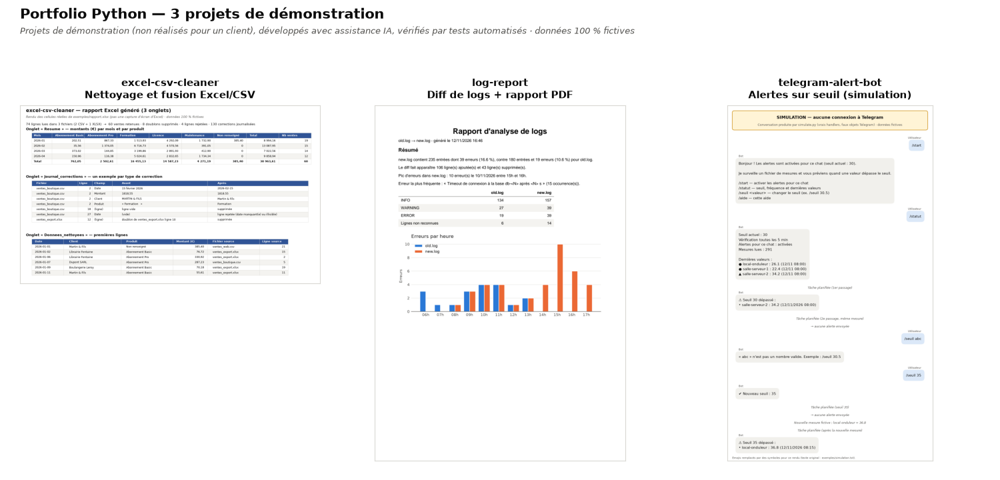
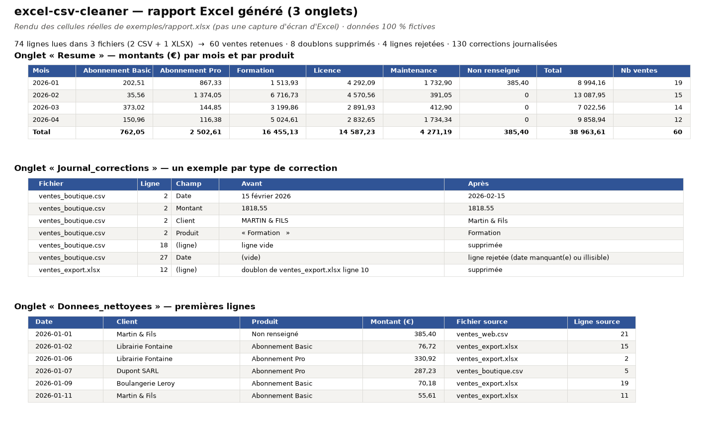
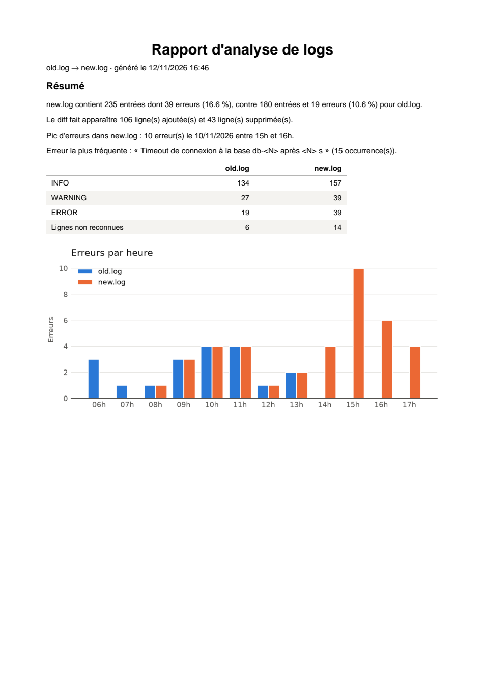
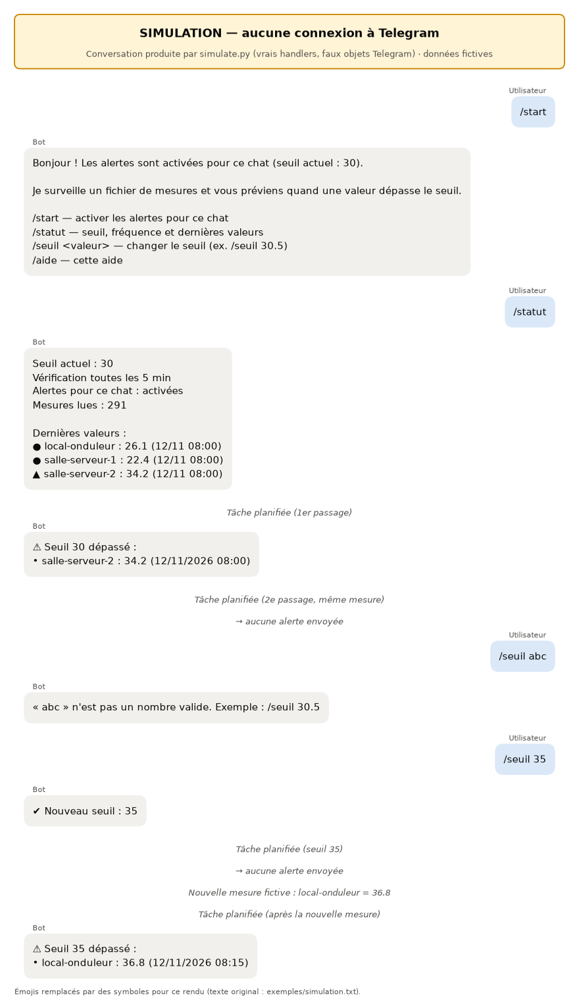

# Portfolio Python — automatisation de données, rapports et alertes



Trois **projets de démonstration** en Python, conçus pour montrer des prestations freelance courantes :
nettoyer des fichiers Excel/CSV, analyser des logs avec un rapport PDF, et envoyer des alertes via un bot Telegram.

> **Transparence**
> - Ce sont des projets de démonstration : **aucun n'a été réalisé pour un client**.
> - Ils ont été **développés avec l'assistance d'une IA** (Claude), puis relus, exécutés et **vérifiés par des tests automatisés** (108 tests).
> - Toutes les données sont **100 % fictives**, générées par script. Aucune donnée réelle.

## Les démonstrations

| Projet | Problème résolu | Résultat produit | Technologies |
|---|---|---|---|
| [**excel-csv-cleaner**](excel-csv-cleaner/) | Des exports de ventes hétérogènes (CSV, Excel) avec doublons, dates et montants dans tous les formats, noms de clients mal saisis | Un classeur Excel propre en 3 onglets : données nettoyées, résumé mensuel, **journal de chaque correction** | pandas, openpyxl |
| [**log-report**](log-report/) | Comparer deux versions d'un fichier de log et comprendre ce qui a changé | Diff ligne à ligne, erreurs par heure, top 5 des erreurs, **rapport PDF de 2 pages** avec graphiques | pandas, matplotlib, reportlab |
| [**telegram-alert-bot**](telegram-alert-bot/) | Être prévenu sur son téléphone quand une mesure dépasse un seuil | Bot Telegram avec commandes (`/statut`, `/seuil`…) et **vérification planifiée** sans alertes en double | python-telegram-bot, APScheduler |

### Aperçus

| excel-csv-cleaner | log-report | telegram-alert-bot |
|---|---|---|
| [](portfolio-assets/excel-csv-cleaner-apercu.png) | [](portfolio-assets/log-report-page-1.png) | [](portfolio-assets/telegram-alert-bot-simulation.png) |
| Rendu des cellules du fichier généré | Rendu exact du PDF généré | **Simulation** hors ligne (aucune connexion à Telegram) |

La nature de chaque visuel est détaillée dans [portfolio-assets/README.md](portfolio-assets/README.md).

## Points communs aux trois projets

- **Testés** : pytest pour chaque projet, sans réseau pour le bot ; vérification croisée des résultats avec des outils indépendants (`awk`, `grep`, `diff`).
- **Traçables** : chaque correction, rejet ou alerte est expliqué (journal Excel, diff exporté, résumé auto-rédigé).
- **Reproductibles** : données générées avec une graine fixe, dépendances aux versions figées, un environnement virtuel par projet.
- **Honnêtes sur leurs limites** : chaque README a une section « Limites ».
- **Sécurité** : aucun secret dans le dépôt ; le token Telegram est lu dans une variable d'environnement (`.env` ignoré par git).

## Lancer les tests

Prérequis : Python 3.11 ou plus récent.

```bash
./run_tests.sh            # crée les environnements virtuels si besoin, puis lance les 3 suites
```

Ou projet par projet :

```bash
cd excel-csv-cleaner
python3 -m venv .venv && .venv/bin/pip install -r requirements-dev.txt
.venv/bin/python -m pytest
```

Résultat attendu : `47 passed` (excel-csv-cleaner), `15 passed` (log-report), `46 passed` (telegram-alert-bot).

## Structure du dépôt

```
excel-csv-cleaner/    nettoyage et fusion Excel/CSV → rapport Excel
log-report/           diff + statistiques de logs → rapport PDF
telegram-alert-bot/   bot d'alertes sur seuil (+ simulation hors ligne)
portfolio-assets/     visuels du portfolio et script qui les génère
run_tests.sh          lance toutes les suites de tests
```

---

### English summary

Three Python **demo projects** (not client work), built **with AI assistance** and verified by automated tests
(108 pytest tests), using **100 % synthetic data**: an Excel/CSV cleaner producing a traceable 3-sheet report,
a log diff/statistics tool producing a 2-page PDF report, and a Telegram threshold-alert bot with an offline simulation.
