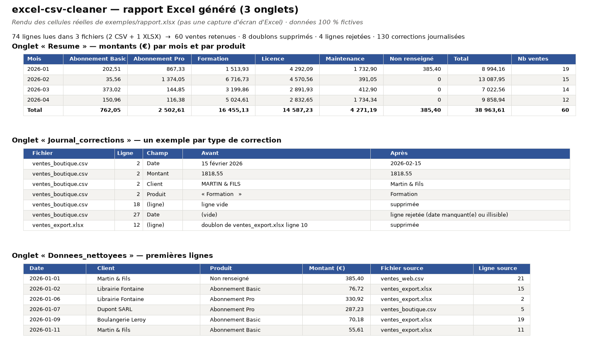

# excel-csv-cleaner

> Projet de démonstration — non réalisé pour un client.
> Développé avec assistance IA, vérifié par 47 tests automatisés. Données 100 % fictives.


<sub>Rendu des cellules réelles de `exemples/rapport.xlsx` (pas une capture d'écran d'Excel).</sub>

## Le problème

Plusieurs exports de ventes arrivent de sources différentes : un CSV de caisse au format Windows, un export web,
un fichier Excel. Les mêmes ventes y figurent parfois deux fois, les dates sont écrites de trois façons,
les montants avec virgule, point ou symbole €, et les noms de clients sont mal saisis
(`DUPONT SARL`, `Dupond SARL`, `  Dupont  SARL `). Fusionner tout ça à la main est long et source d'erreurs.

## La solution

Une commande qui lit tout un dossier, nettoie, dédoublonne et produit un classeur Excel **auditable** :
chaque modification est tracée (fichier, ligne, champ, avant → après).

```bash
python clean.py --input data/ --output rapport.xlsx
```

## Fonctionnalités

| Problème dans les fichiers source | Traitement |
|---|---|
| Séparateurs `;` ou `,`, encodage UTF-8 ou Windows (cp1252) | détection automatique |
| En-têtes différents (`Date vente`, `date_vente`, `Article`, `Montant (€)`…) | correspondance par synonymes |
| Dates `12/03/2026`, `2026-03-12`, `12 mars 2026`, `1er avril 2026`, vraies dates Excel | converties en ISO `AAAA-MM-JJ` |
| Montants `1234.50`, `1234,5`, `1 234,50 €`, `1.234,50` | convertis en nombres |
| Clients : casse, accents, `&`/`et`, fautes de frappe (`Dupond`, `Garrage`) | ramenés au nom officiel d'un référentiel |
| Espaces parasites dans les produits | supprimés |
| Client ou produit vide | `Client inconnu` / `Non renseigné` (la vente est gardée) |
| Date ou montant vide ou illisible | ligne rejetée **et journalisée** |
| Lignes vides | supprimées |
| Doublons (mêmes date, client, produit, montant **après** normalisation) | supprimés, 1re occurrence conservée |

Le rapport contient 3 onglets :
1. **Donnees_nettoyees** — une ligne par vente, avec le fichier et la ligne d'origine ;
2. **Resume** — montants par mois × produit, totaux, nombre de ventes, indicateurs de nettoyage ;
3. **Journal_corrections** — fichier, ligne, champ, valeur avant, valeur après.

## Technologies

Python 3.11+ · **pandas** (agrégations) · **openpyxl** (lecture/écriture Excel, mise en forme) ·
`difflib` (rapprochement approximatif des noms) · **pytest**.

## Installation

```bash
cd excel-csv-cleaner
python3 -m venv .venv
source .venv/bin/activate          # Windows : .venv\Scripts\activate
pip install -r requirements.txt    # requirements-dev.txt pour les tests
```

## Utilisation

```bash
python generate_sample_data.py                      # (re)crée data/ et referentiel/clients.csv (fictifs)
python clean.py --input data/ --output rapport.xlsx
```

Option `--clients chemin.csv` : référentiel des noms de clients (colonne `client`). Par défaut
`referentiel/clients.csv` s'il existe ; sans référentiel, les noms sont seulement nettoyés (espaces).

## Exemple de résultat

```
Référentiel clients : referentiel/clients.csv
Lignes lues : 74 | vides : 2 | rejetées : 4 | doublons : 8
Ventes retenues : 60 | total : 38963.61 €
Corrections journalisées : 130
Rapport écrit : exemples/rapport.xlsx
```

Fichier complet : [`exemples/rapport.xlsx`](exemples/rapport.xlsx). Extrait du journal :

| Fichier | Ligne | Champ | Avant | Après |
|---|---|---|---|---|
| ventes_boutique.csv | 2 | Date | 15 février 2026 | 2026-02-15 |
| ventes_boutique.csv | 2 | Client | MARTIN & FILS | Martin & Fils |
| ventes_boutique.csv | 3 | Montant | 820,30 € | 820.30 |
| ventes_boutique.csv | 4 | Client | Garrage Moreau | Garage Moreau |
| ventes_export.xlsx | 12 | (ligne) | doublon de ventes_export.xlsx ligne 10 | supprimée |

**Vérification croisée** : la somme des montants exploitables bruts (45 214,60 €) moins la somme des
8 doublons retrouvés via le journal (6 250,99 €) donne exactement le total du rapport (38 963,61 €).

## Tests

```bash
pip install -r requirements-dev.txt
python -m pytest -v        # 47 tests
```

Les tests régénèrent les données dans un dossier temporaire et comparent le résultat à la « vérité terrain »
fournie par le générateur : nombre de doublons, dates ISO, montants numériques, total hors doublons,
clients ramenés au référentiel, contenu des 3 onglets, CLI.

## Structure

```
clean.py                 # CLI
cleaner/normalize.py     # dates, montants, clients, produits (fonctions pures)
cleaner/pipeline.py      # lecture CSV/XLSX, nettoyage, dédoublonnage, journal
cleaner/excel_report.py  # écriture et mise en forme du rapport
generate_sample_data.py  # données fictives + vérité terrain
```

## Limites

- Les dates numériques sont lues au format **français** (jour/mois/année) : `03/04/2026` = 3 avril.
- Un montant `1,234` ou `1.234` (un seul séparateur) est lu comme décimal (1,23), pas comme « 1 234 ».
- Deux ventes réellement identiques (même jour, client, produit et montant) sont vues comme un doublon ;
  en production on s'appuierait sur un numéro de facture.
- Le rapprochement approximatif des clients (seuil 0,85) peut confondre deux noms très proches ; le journal permet de le vérifier.
- Seule la première feuille de chaque fichier Excel est lue ; pas de support `.xls` (ancien format).
- Le contenu des fichiers générés est reproductible, mais un `.xlsx` régénéré diffère par ses métadonnées de date.
