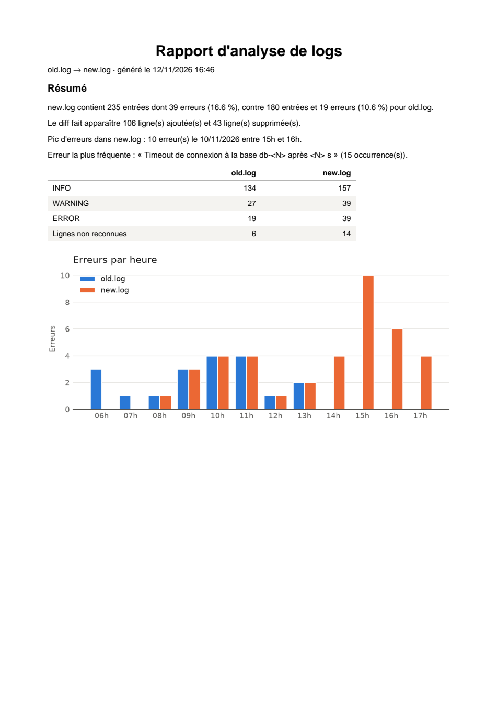
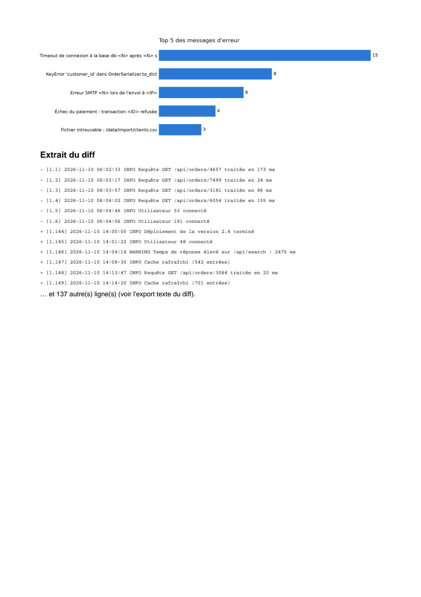

# log-report

> Projet de démonstration — non réalisé pour un client.
> Développé avec assistance IA, vérifié par 15 tests automatisés. Données 100 % fictives.

<p>


</p>
<sub>Rendu exact des deux pages de <code>exemples/rapport.pdf</code>.</sub>

## Le problème

Après une mise en production, les erreurs augmentent. Il faut comparer le fichier de log d'avant et d'après,
repérer **ce qui a changé**, **quand** les erreurs se produisent et **lesquelles** reviennent le plus — puis
en faire un compte rendu lisible par quelqu'un qui n'ouvrira jamais le fichier brut.

## La solution

```bash
python report.py old.log new.log --pdf rapport.pdf
```

Une commande qui produit le diff, les statistiques et un **rapport PDF de 2 pages** avec résumé rédigé automatiquement.

## Fonctionnalités

- **Diff** ligne à ligne : lignes ajoutées et supprimées, avec leur numéro de ligne.
- **Erreurs par heure**, heures sans erreur incluses.
- **Top 5 des messages d'erreur**, regroupés par modèle : `db-01` / `db-02` → `db-<N>`, IP → `<IP>`, identifiants → `<ID>`.
- **Rapport PDF** (2 pages max) : résumé, tableau des niveaux, graphique horaire comparatif, top 5, extrait du diff.
- **Exports** (`--export-dir`) : `diff.txt` complet, `erreurs_par_heure.csv`, `top_erreurs.csv`.
- Lignes non standard (traces Python) comptées à part, sans faire échouer l'analyse.

## Technologies

Python 3.11+ · **pandas** (statistiques) · **matplotlib** (graphiques) · **reportlab** (PDF) · `difflib` (diff) · **pytest**.

## Installation

```bash
cd log-report
python3 -m venv .venv
source .venv/bin/activate          # Windows : .venv\Scripts\activate
pip install -r requirements.txt    # requirements-dev.txt pour les tests
```

## Utilisation

```bash
python generate_sample_data.py                      # crée data/old.log et data/new.log (fictifs)
python report.py data/old.log data/new.log --pdf rapport.pdf --export-dir exemples/
```

Format de log attendu : `2026-11-10 14:00:00 INFO message` (millisecondes et `T` acceptés ; niveaux `INFO`,
`WARNING`/`WARN`, `ERROR`).

## Exemple de résultat

```
== Top 5 des messages d'erreur (new.log) ==
1. (15) Timeout de connexion à la base db-<N> après <N> s
2. (8) KeyError 'customer_id' dans OrderSerializer.to_dict
3. (6) Erreur SMTP <N> lors de l'envoi à <IP>
4. (4) Échec du paiement : transaction <ID> refusée
5. (3) Fichier introuvable : /data/import/clients.csv

== Résumé ==
- new.log contient 235 entrées dont 39 erreurs (16.6 %), contre 180 entrées et 19 erreurs (10.6 %) pour old.log.
- Le diff fait apparaître 106 ligne(s) ajoutée(s) et 43 ligne(s) supprimée(s).
- Pic d'erreurs dans new.log : 10 erreur(s) le 10/11/2026 entre 15h et 16h.
```

Fichiers produits : [`exemples/rapport.pdf`](exemples/rapport.pdf), [`exemples/diff.txt`](exemples/diff.txt),
[`exemples/erreurs_par_heure.csv`](exemples/erreurs_par_heure.csv), [`exemples/top_erreurs.csv`](exemples/top_erreurs.csv).

**Vérification croisée** : erreurs par heure recomptées avec `awk`, niveaux avec `grep -c`, diff avec la
commande système `diff` (43 suppressions, 106 ajouts) — résultats identiques à ceux du programme.

## Tests

```bash
pip install -r requirements-dev.txt
python -m pytest -v        # 15 tests
```

Diff exact sur des fixtures connues, statistiques vérifiées sur un mini fichier dont le résultat est calculé
à la main (ex æquo compris), CLI, exports, PDF valide de 2 pages au maximum.

## Structure

```
report.py                # CLI
logreport/parsing.py     # lecture et découpage des lignes
logreport/diff.py        # diff ligne à ligne
logreport/stats.py       # erreurs par heure, top des messages
logreport/charts.py      # graphiques matplotlib
logreport/pdf.py         # rapport PDF
generate_sample_data.py  # logs fictifs
```

## Limites

- Diff **ligne à ligne exact** : deux exécutions distinctes (horodatages différents) apparaissent entièrement
  modifiées ; comparer deux versions d'une application demanderait de comparer les messages sans horodatage.
- `difflib` convient à quelques dizaines de milliers de lignes ; au-delà, `diff` système ou un traitement en flux.
- Un seul format de log reconnu (regex dans `parsing.py`, facile à adapter).
- Le regroupement par modèle peut fusionner des messages qui ne diffèrent que par un nombre significatif (codes HTTP).
- Statistiques et top 5 portent sur le **nouveau** fichier ; le graphique horaire compare les deux.
- L'extrait du diff dans le PDF est limité à 12 lignes ; le diff complet est dans l'export texte.

## Licence

[MIT](../LICENSE) — voir le fichier à la racine du dépôt.
