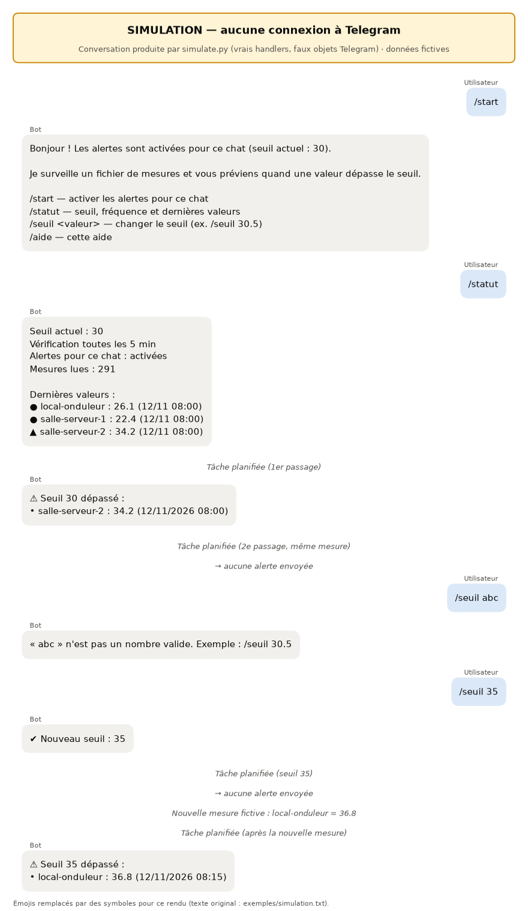

# telegram-alert-bot

> Projet de démonstration — non réalisé pour un client.
> Développé avec assistance IA, vérifié par 51 tests automatisés sans réseau **et par un test réel sur Telegram**
> (13/11/2026, bot de test, téléphone réel). Données 100 % fictives.



<sub><b>Simulation</b> produite par <code>simulate.py</code> : les vrais handlers du bot sont appelés avec de faux
objets Telegram. Aucune connexion à Telegram, aucun token. Ce n'est pas une capture d'écran de l'application.</sub>

## Le problème

Des capteurs (températures de salles techniques, ici fictives) écrivent leurs mesures dans un fichier CSV.
Personne ne surveille ce fichier en continu : il faut être **prévenu sur son téléphone** dès qu'une valeur
dépasse un seuil, et pouvoir ajuster ce seuil sans toucher au serveur.

## La solution

Un bot Telegram qui relit le CSV toutes les N minutes et envoie une alerte aux abonnés quand la dernière
mesure d'un capteur dépasse le seuil — **une seule fois par mesure**, sans spam.

## Fonctionnalités

| Commande | Effet |
|---|---|
| `/start` | active les alertes pour ce chat |
| `/aide` | liste des commandes |
| `/statut` | seuil, fréquence, dernière valeur de chaque capteur (🟢 / 🔴) |
| `/seuil <valeur>` | change le seuil (`30`, `30.5`, `30,5`) ; sans valeur, affiche le seuil actuel |

- **Tâche planifiée** configurable (`INTERVALLE_MINUTES`).
- **Anti-doublon** : une mesure déjà signalée ne l'est plus ; changer le seuil remet le suivi à zéro.
- **Validation** des saisies (`/seuil abc`, `/seuil 1 2`, `nan`, `inf` refusés avec un message clair).
- **Restriction d'accès** facultative (`ALLOWED_CHAT_IDS`).
- **Robustesse** : CSV absent ou lignes invalides n'arrêtent pas le bot ; un chat qui bloque le bot est désabonné.
- **Sécurité du token** : lu dans l'environnement, jamais dans le code ; logs `httpx` (qui contiendraient le token) masqués.

## Technologies

Python 3.11+ · **python-telegram-bot 22** (asynchrone) · **APScheduler** via la JobQueue · **python-dotenv** ·
**pytest** + `unittest.mock`.

## Installation et configuration

### 1. Créer un bot avec BotFather

1. Dans Telegram, ouvrez **@BotFather** (compte officiel, coche bleue).
2. Envoyez `/newbot`, choisissez un nom puis un identifiant se terminant par `bot`.
3. BotFather renvoie un **token** `123456789:AA…`. Il donne le contrôle total du bot : ne le partagez pas,
   ne le commitez jamais. En cas de fuite : `/revoke` dans BotFather.

### 2. Installer

```bash
cd telegram-alert-bot
python3 -m venv .venv
source .venv/bin/activate          # Windows : .venv\Scripts\activate
pip install -r requirements.txt
cp .env.example .env               # puis collez votre token dans .env
python generate_sample_data.py     # crée mesures.csv (fictif)
```

| Variable | Défaut | Rôle |
|---|---|---|
| `TELEGRAM_BOT_TOKEN` | — (obligatoire) | token BotFather |
| `MESURES_CSV` | `mesures.csv` | fichier surveillé |
| `INTERVALLE_MINUTES` | `5` | fréquence de vérification (`0.5` = 30 s) |
| `SEUIL_INITIAL` | `30` | seuil au démarrage |
| `ALLOWED_CHAT_IDS` | vide (tout le monde) | chats autorisés, séparés par des virgules |

### 3. Lancer

```bash
python bot.py
```

Envoyez `/start` au bot. Avec les données générées, `salle-serveur-2` (34,2) dépasse 30 : une alerte arrive
~10 s après le démarrage. Pour simuler de nouvelles mesures pendant que le bot tourne :

```bash
python generate_sample_data.py --ajouter --pic local-onduleur
```

## Essayer sans Telegram

```bash
python simulate.py         # rejoue un scénario complet hors ligne, sans token
```

Extrait de la sortie ([`exemples/simulation.txt`](exemples/simulation.txt)) :

```
   [Tâche planifiée (1er passage)]
        Bot : ⚠️ Seuil 30 dépassé :
              • salle-serveur-2 : 34.2 (12/11/2026 08:00)
   [Tâche planifiée (2e passage, même mesure)]
   [→ aucune alerte envoyée]
Utilisateur : /seuil abc
        Bot : « abc » n'est pas un nombre valide. Exemple : /seuil 30.5
```

## Tests

```bash
pip install -r requirements-dev.txt
python -m pytest -v        # 51 tests, toute connexion réseau bloquée par tests/conftest.py
```

Logique de seuil (égalité, dernière mesure, anti-doublon), parsing de `/seuil` (valides et invalides),
lecture du CSV (lignes invalides, colonne manquante, fichier absent), handlers et tâche planifiée avec des
objets simulés, configuration, construction de l'application, scénario de simulation complet,
vérification du token sans fuite (`check_token.py`).

## Test réel sur Telegram (13/11/2026)

Bot de test créé avec BotFather, token dans `.env`, bot lancé 15 minutes au maximum (aucun service installé),
vérification toutes les 30 s, mesures fictives :

| Étape | Résultat observé sur le téléphone |
|---|---|
| `/start` | message de bienvenue |
| alerte initiale | reçue **4 s** après `/start` (`salle-serveur-2 : 34.2`) |
| `/statut` | seuil, 291 mesures, 🔴 / 🟢 par capteur |
| `/seuil abc` | refus avec message explicite |
| `/seuil 35` | « ✅ Nouveau seuil : 35 », puis aucune alerte (34,2 < 35) |
| nouvelle mesure fictive 36,8 | alerte reçue **9 s** après l'écriture dans le CSV, une seule fois |

Journal du bot : aucune erreur, **aucune trace du token**.

**Défaut trouvé et corrigé grâce à ce test** : une vérification lancée avant le premier `/start` marquait
l'alerte comme envoyée, si bien que le premier abonné ne la recevait jamais. Un test de non-régression
reproduit le cas.

Pour vérifier votre propre token sans l'afficher : `python check_token.py`.

## Structure

```
bot.py                   # configuration, commandes, tâche planifiée, lancement
alerting.py              # logique pure : CSV, seuil, messages (sans Telegram)
simulate.py              # démonstration hors ligne (SIMULATION)
generate_sample_data.py  # mesures.csv fictif, option --ajouter
.env.example             # modèle de configuration (sans token)
```

## Limites

- Test réel limité : un bot, un abonné, 15 minutes, quelques mesures ; pas de test de charge ni de longue durée.
- Les heures des alertes sont celles écrites dans le CSV, **sans fuseau horaire** (un CSV en UTC affichera
  16:35 sur un téléphone réglé à 17:35).
- Pas de reprise automatique si le bot est arrêté : il faut le relancer (ou le superviser, hors périmètre de la démo).
- **État en mémoire** : seuil, abonnés et alertes envoyées sont perdus au redémarrage (`PicklePersistence` possible).
- Un seul seuil pour tous les capteurs ; pas de seuil bas ni d'alerte de retour à la normale.
- Sans `ALLOWED_CHAT_IDS`, **n'importe qui** trouvant le bot peut s'abonner et changer le seuil.
- Pas de commande de désabonnement.
- CSV relu entièrement à chaque passage : adapté à quelques milliers de lignes.
- Mode *polling* ; un déploiement en production utiliserait plutôt un webhook.

## Licence

[MIT](../LICENSE) — voir le fichier à la racine du dépôt.
